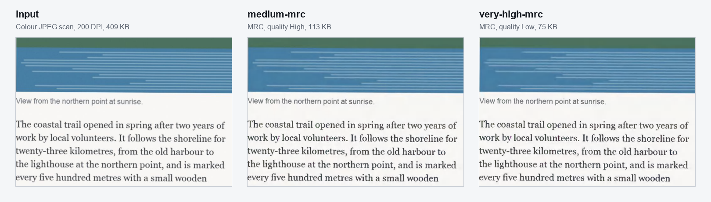
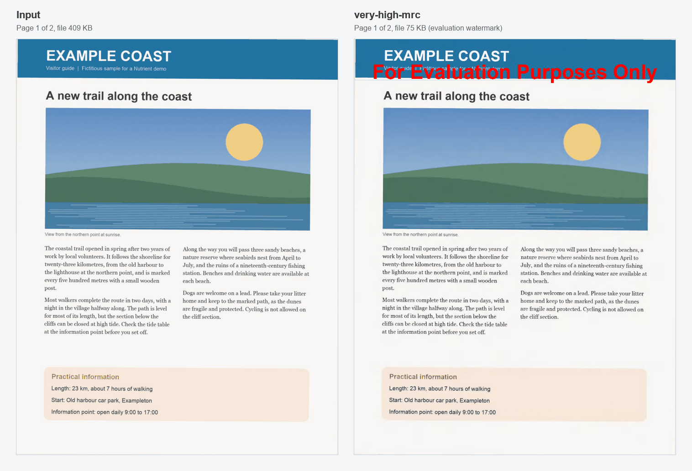

# Nutrient MRC Compression

A Nutrient.io demo that compresses a scanned colour PDF with GdPicture.NET Mixed Raster Content (MRC) at five quality levels, with and without linearization, and reports the size of each result.



1. **Input.** One PDF, by default the fictitious colour scan in `samples/`.
2. **MRC.** `GdPicturePDFReducer` splits each scanned page into layers: a 1-bit mask for the text (JBIG2, with character repair), and colour foreground and background layers downsampled to 150 DPI and compressed separately. Colour detection keeps grey pages in grey.
3. **Clean-up.** The reducer also packs the document and its fonts and removes metadata, thumbnails, page piece info, logical structure, JavaScript and embedded files. The output is PDF 1.7.
4. **Quality levels.** Five runs, from `ImageQualityVeryVeryHigh` (largest file) to `ImageQualityLow` (smallest file).
5. **Linearization.** The five levels are written a second time with Fast Web View, so a browser can show the first page before the whole file is downloaded.
6. **Report.** The size of each output and the reduction compared with the input.

## Prerequisites

- .NET SDK 10
- Windows, macOS or Linux

## Environment variables

Keys are only read from environment variables, never from code. Start from `.env.example`.

| Variable | Purpose | Default |
|---|---|---|
| `GDPICTURE_LICENSE_KEY` | GdPicture.NET license key | empty = evaluation mode |

In evaluation mode GdPicture stamps a watermark on each output page and a process can run for one hour. A rejected key falls back to evaluation mode with a message.

## Build and run

```bash
dotnet build
```

```bash
set -a && source .env && set +a && dotnet run
```

```bash
dotnet run -- /path/to/scan.pdf --output /path/to/folder
```

## Usage

| Argument | Description | Default |
|---|---|---|
| `input.pdf` | PDF to compress | `samples/color-scan-sample.pdf` |
| `-o`, `--output DIR` | Folder for the 10 output files | `output` |
| `-h`, `--help` | Show the help | |

Relative paths are resolved against the current directory. The output files are named after their level:

| File | MRC image quality | Linearized |
|---|---|---|
| `01-very-low-mrc.pdf` | `ImageQualityVeryVeryHigh` | no |
| `02-low-mrc.pdf` | `ImageQualityVeryHigh` | no |
| `03-medium-mrc.pdf` | `ImageQualityHigh` | no |
| `04-high-mrc.pdf` | `ImageQualityMedium` | no |
| `05-very-high-mrc.pdf` | `ImageQualityLow` | no |
| `06-...` to `10-...` | same five levels | yes |

Results on the sample (2 pages, colour JPEG at 200 DPI, 409 KB), in evaluation mode:

| Output | Size | Change |
|---|---|---|
| `01-very-low-mrc.pdf` | 754 KB | 84% larger |
| `02-low-mrc.pdf` | 212 KB | 48% smaller |
| `03-medium-mrc.pdf` | 113 KB | 72% smaller |
| `04-high-mrc.pdf` | 92 KB | 77% smaller |
| `05-very-high-mrc.pdf` | 75 KB | 82% smaller |
| `06-` to `10-...-linearized.pdf` | about 1 KB more than the same level | |

The sample is already a compressed JPEG, so the highest quality level makes it larger. The gain is much bigger on real scans, which are usually larger and less compressed. Linearization adds about 1 KB per file.

The layout and the colours are kept; only the image layers are recompressed:



## Sample

`samples/color-scan-sample.pdf` is a fictitious two-page visitor guide (text, a photo-like picture, a table, a bar chart and colour areas on a tinted, noisy paper background), saved as one JPEG image per page. It is generated by `samples/generate_color_scan.py` (Pillow):

```bash
python3 -m venv .venv && .venv/bin/pip install -r samples/requirements.txt
```

```bash
.venv/bin/python samples/generate_color_scan.py
```

## Project layout

| Path | Content |
|---|---|
| `Program.cs` | Command line, licensing, MRC levels and size report |
| `MrcCompression.csproj` | Project file (GdPicture.API) |
| `samples` | Fictitious colour scan and its generator |
